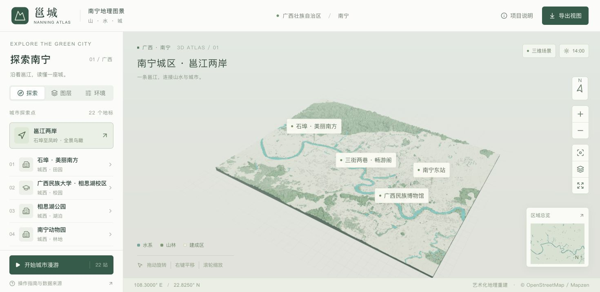
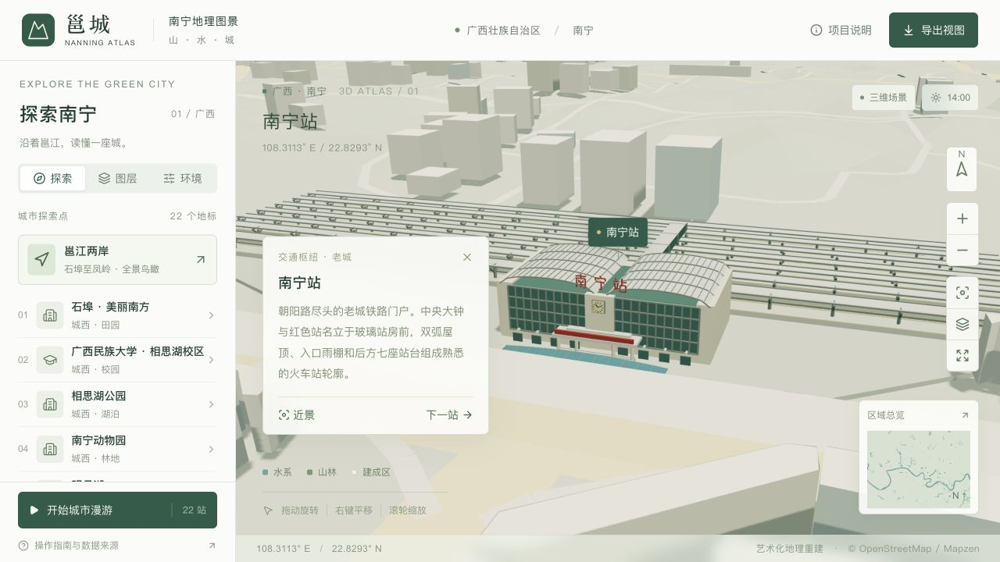
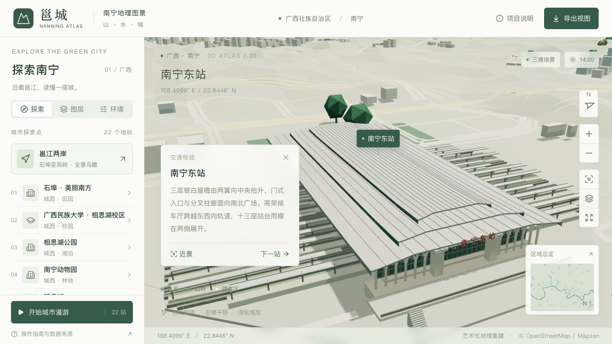

<div align="center">

# 邕城 · Nanning City Atlas

**一张可以旋转、缩放的南宁三维地图。**

用公开地图数据和 Blender 模型制作，可以查看城市地标、自动游览，也可以切换光照。

[在线游览](https://wcqqq1214.github.io/nanning-city-atlas/) · [数据来源](docs/DATA_SOURCES.md) · [设计说明](docs/DESIGN.md) · [检查与验证](docs/VALIDATION.md)


</div>



## 地图里有什么

项目覆盖南宁约 **37 × 28 km** 的城区与周边，西至石埠，包含相思湖、老城、青秀山和五象新区。地图标出了河流、湖泊、道路和主要地标。打开网页就能看，无需地图密钥或后端服务。

| OSM 建筑轮廓 | 程序化补充建筑 | 城市探索点 | 独立地标模型 |
| :---: | :---: | :---: | :---: |
| **6,035 个** | **13,877 栋** | **37 处** | **33 个** |

> 基于 2026-09-08 的 OpenStreetMap 快照。地图做了简化，程序补充的建筑不代表真实位置和高度。

## 可以怎么用

| 功能 | 可以做什么 |
| --- | --- |
| **地标探索** | 点击列表或地图标记，查看 37 个地点；建筑等地标提供近景，高架按整体路段展示。 |
| **城市漫游** | 自动在地标间切换，手动操作地图或选择地标会暂停。 |
| **自由视角** | 旋转、平移、缩放，切换俯视、倾斜、正北和全景视角，支持缓慢环绕与全屏。 |
| **光照与画质** | 选择晨光、日间、日落、夜色；夜间显示窗灯、地标亮化与沿路光晕，支持自动、流畅、精细画质。 |
| **图层与高度** | 分别开关建筑、树木、道路桥梁、铁路轨道、水面和地名标注，调整山地和建筑的高度比例。 |
| **截图与移动端** | 导出当前城市画面为 PNG（不含菜单与 HTML 标注）；手机上的菜单和地标介绍可以收起。 |

夜景采用程序化窗灯与示意亮化，不代表实地照明分布。灯光随时间渐变，跟随建筑、道路图层和高度比例；通过材质着色与批量光晕实现，无需额外下载模型或增加逐灯阴影。

鼠标左键旋转、右键平移、滚轮缩放；触屏单指旋转、双指平移／缩放。手机自动选择轻量模型，也可手动切换画质。

<details>
<summary>查看更多场景预览</summary>

以下为仓库中的建模预览，网页效果以在线游览为准。

| 广西文化艺术中心 | 广西体育中心 |
| --- | --- |
|  |  |

| 南宁站 | 南宁东站 |
| --- | --- |
|  |  |

</details>

## 技术与资源

React + TypeScript 界面，Three.js 场景，vinext + Vite 构建；模型使用 Blender 制作，以 Draco 压缩 GLB 发布。

仓库包含约 25.58 MB 精细模型与 17.64 MB 轻量模型（十进制 MB）。可编辑 `.blend` 仅在本地保存，浏览网页无需安装 Blender。建模输入、历史基准及恢复限制见 [建模说明](docs/MODELING.md)。

## 本地运行

建议使用 **Node.js 24**，与仓库 CI 保持一致。仓库已包含预生成模型，浏览项目无需安装 Blender。

```sh
git clone --branch dev https://github.com/wcqqq1214/nanning-city-atlas.git
cd nanning-city-atlas
npm ci
npm run dev
```

打开终端输出的 Local 地址，默认是 `http://localhost:3000`。

### 检查与静态构建

```sh
npm run typecheck
npm run lint
npm test
npm run build:pages
npm run preview
```

静态文件生成于 `out/`，默认预览地址为 `http://127.0.0.1:4300/nanning-city-atlas/`。固定视角检查入口为同一路径下的 `inspect/`；Python 测试、浏览器检查、端口和根路径构建方式见 [检查与验证](docs/VALIDATION.md)。

开发提交推送至 `origin/dev`，dev 推送不触发 CI；面向 `main` 的 PR 自动检查与构建。更新 `main` 需明确授权，主分支推送或手动运行工作流会检查并发布到 GitHub Pages。Fork 后在 **Settings → Pages → Source** 选择 **GitHub Actions**。

## 数据来源与精度

- **建筑与地标**：缺失高度采用估算值，程序化建筑用于补充街区；地标做了简化，部分模型放大了尺寸，方便在全景中看清。
- **地形与水面**：Copernicus GLO-30 高程重采样为约 60 m 网格，经过城区去突起、商场场地平整、1.35 倍高差放大及岸线局部处理，不代表工程高程。
- **植被与光照**：树位与连片树冠为示意，模拟光照不对应实时天气或严格天文日照。

不能用于测绘、导航、洪水模拟或建筑尺寸量测。详细依据见 [数据来源](docs/DATA_SOURCES.md)。

## 文档导航

- [数据来源与精度](docs/DATA_SOURCES.md)
- [界面与交互](docs/DESIGN.md) · [手机体验](docs/design/MOBILE.md)
- [模型重建与阶段记录](docs/MODELING.md) · [建模输入与恢复限制](data/README.md)
- [测试、浏览器检查与静态预览](docs/VALIDATION.md)
- [完整专题导航](docs/README.md)：道路、桥梁、地形、植被和地标说明

## 许可与署名

| 内容 | 许可／署名 |
| --- | --- |
| 代码 | [MIT](LICENSE) |
| 地理数据库及衍生数据库 | ODbL 1.0，**© OpenStreetMap contributors** |
| 高程数据及衍生模型 | 保留上游归属要求，见 [第三方署名](licenses/ATTRIBUTION.md) |
| Draco 解码器 | [Apache 2.0](public/draco/LICENSE.txt) |

代码许可不覆盖第三方地理数据。重新分发模型、Blender 场景、渲染图或地理数据时，请保留 [OSM 与高程数据署名](licenses/ATTRIBUTION.md)。
